<p align="center">
  
</p>

<h1 align="center">Optara</h1>

<p align="center">
  <strong>Uncapped, cash-settled options on Monad, with portfolio margin, permissionless liquidation and an insurance fund.</strong><br />
  Every option is a standard ERC-20 token that trades on Kuru's order book.
</p>

<p align="center">
  <a href="https://optara-2et.pages.dev">Launch the app (Monad testnet)</a> ·
  <a href="https://optara-2et.pages.dev/docs/introduction">In-app docs</a> ·
  <a href="docs/README.md">Protocol specification</a> ·
  <a href="deployments/testnet-contracts.md">Testnet contracts</a> ·
  <a href="https://x.com/Oxoptara">@Oxoptara</a>
</p>

---

## Contents

1. [What Optara is](#1-what-optara-is)
2. [How it works in one picture](#2-how-it-works-in-one-picture)
3. [Core concepts](#3-core-concepts)
4. [Protocol architecture](#4-protocol-architecture)
5. [Margin and risk](#5-margin-and-risk)
6. [Oracles](#6-oracles)
7. [Trading and the Kuru integration](#7-trading-and-the-kuru-integration)
8. [Liquidation](#8-liquidation)
9. [Settlement and redemption](#9-settlement-and-redemption)
10. [Fees, insurance and keeper rewards](#10-fees-insurance-and-keeper-rewards)
11. [Governance and security](#11-governance-and-security)
12. [Capital efficiency and composability](#12-capital-efficiency-and-composability)
13. [User guide](#13-user-guide)
14. [Risks every user should understand](#14-risks-every-user-should-understand)
15. [Troubleshooting and FAQ](#15-troubleshooting-and-faq)
16. [Deployments](#16-deployments)
17. [Repository layout](#17-repository-layout)
18. [Developer guide](#18-developer-guide)
19. [Operations: markets, services and hosting](#19-operations-markets-services-and-hosting)
20. [Documentation index](#20-documentation-index)

---

## 1. What Optara is

Optara is an on-chain options protocol on Monad. It lets anyone **write** (sell) and **buy** standard European
calls and puts:

- **Uncapped payoffs.** A call pays `max(S − K, 0)` and a put pays `max(K − S, 0)` per unit of the underlying, with
  no cap, like options on Deribit or Binance.
- **Cash-settled in one stablecoin.** Writers post USDC, never the underlying asset, and payoffs are paid in USDC.
- **Portfolio margin.** A writer's collateral is sized by stress-testing the whole account, not by locking each
  option's worst case. Spreads and hedges need only their real worst loss.
- **Options are ERC-20 tokens.** Every option series has one token. It can be held in a wallet, sent to anyone,
  traded on Kuru or any other venue, or moved into a margin account where it offsets shorts.
- **Kuru is the order book.** Optara clears, margins, liquidates and settles. Kuru (Monad's on-chain CLOB) is where
  option tokens are bought and sold; the app has a built-in Kuru order book, so users never leave Optara to trade.
- **Permissionless and keeper-driven.** Anyone can liquidate unhealthy accounts, finalize expiries and settle
  accounts, and is paid for it.
- **No redemption race.** At expiry every account is settled first, the insurance fund covers any shortfall, and
  every holder is paid the same recovery ratio, whatever order they redeem in.

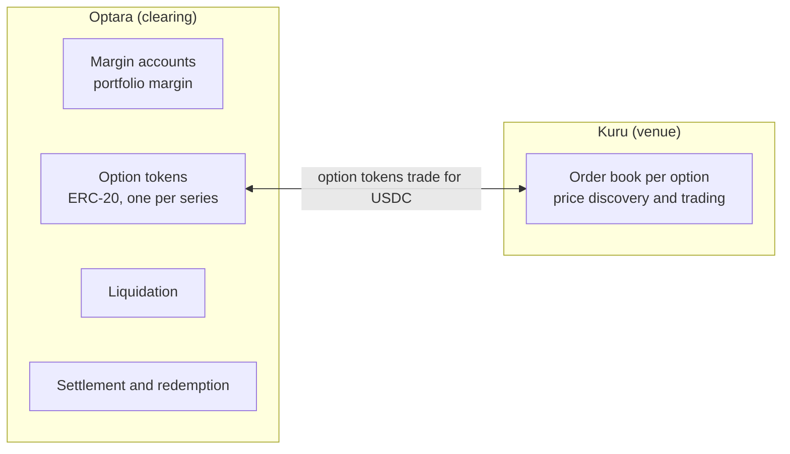

Optara is live on **Monad testnet** with two products, **WETH/USDC** and **MON/USDC**, and is configured for
Monad mainnet against Kuru's production contracts.

---

## 2. How it works in one picture

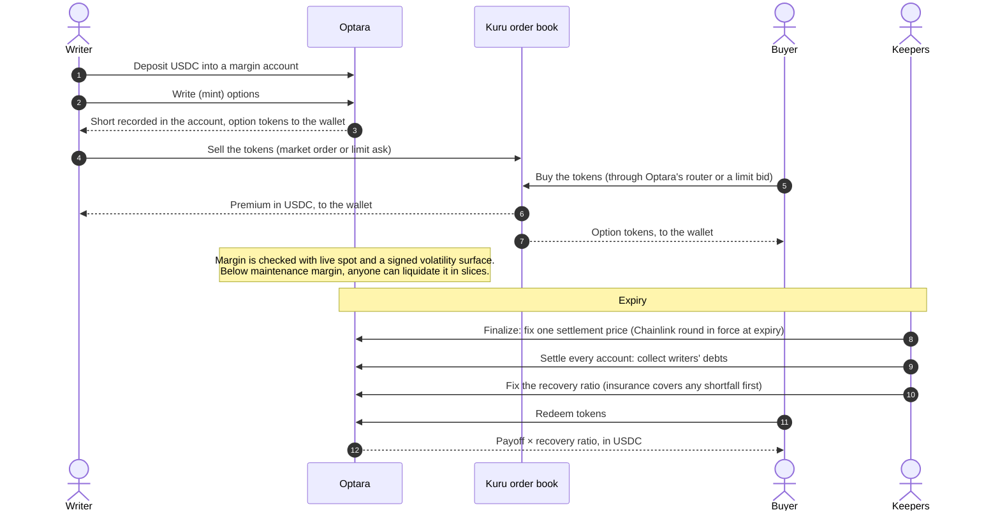

The lifecycle of one option, end to end:

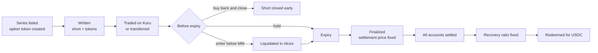

---

## 3. Core concepts

| Term | Meaning |
|---|---|
| **Product** | An underlying paired with a settlement asset, e.g. WETH/USDC. Each product has one spot source, one volatility surface and one risk parameter set. |
| **Series** | One option: product, call or put, strike, contract size, expiry, settlement-price config. Terms are written once and can never change. |
| **Option token (wrapper)** | The ERC-20 long claim of a series (EIP-1167 clone of a verified template, deployed at a deterministic address when the series is created). Only `OptionClearing` mints it, and only against an equal short. |
| **Contract size** | Units of the underlying per option token: 1 WETH for WETH options, 100 MON for MON options. Payoff per token = intrinsic value × contract size. |
| **Subaccount (margin account)** | A ledger account bound to one settlement asset. Holds cash, shorts and internal longs. A wallet can own many; owners can appoint operators. |
| **Write / mint** | `mintExternalLong`: records a short in the writer's subaccount and mints the same quantity of option tokens to a wallet. |
| **Unwrap / wrap** | Move a long from wallet tokens into a subaccount (unwrap; it then counts as a hedge) or back out to tokens (wrap). |
| **Risk bucket** | One subaccount × one underlying. Positions in a bucket offset each other; different underlyings never do. Liquidation works per bucket. |
| **Mark / fair value** | The on-chain Black-76 price of an option from live spot and the signed implied volatility. |
| **IM / MM** | Initial margin (needed to open risk or withdraw) and maintenance margin (needed to avoid liquidation). |
| **Settlement group** | All series sharing one expiry, settlement asset and settlement oracle config. One settlement price and one recovery ratio per group. |
| **Recovery ratio** | The share of each payoff that is paid. 1.0 unless a shortfall exceeds the insurance fund. |
| **Close-only** | A state where only risk-reducing actions are allowed (per account or per product). |
| **Keeper** | Anyone running bots that refresh oracles, finalize expiries, settle accounts or liquidate. |
| **Publisher** | A signer of volatility surfaces. Surfaces need a quorum of publisher signatures. |

Full definitions: [docs/GLOSSARY.md](docs/GLOSSARY.md).

---

## 4. Protocol architecture

### 4.1 Contracts

All core contracts are upgradeable proxies owned by a timelocked `UpgradeAdmin`. Option tokens are immutable clones.

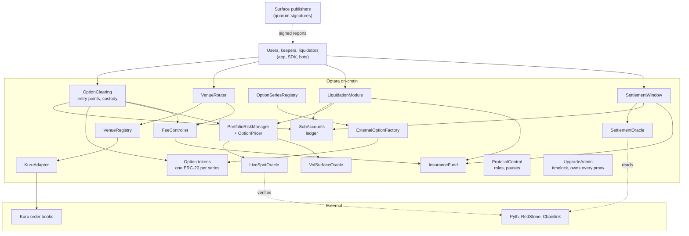

| Contract | Responsibility | Holds funds |
|---|---|---|
| `SubAccounts` | The ledger: owners, operators, cash, signed option balances, per-series totals, settlement-group participants | No |
| `OptionSeriesRegistry` | Approved settlement assets, products and their bounds, write-once series terms | No |
| `ExternalOptionFactory` | Deploys one option token per series at a deterministic address | No |
| `ExternalOptionWrapper` | The ERC-20 (+ permit) option token. Fixed minter and burners | — |
| `OptionClearing` | Every user entry point that moves positions or cash: deposit, withdraw, mint, wrap, unwrap, close; custody of all collateral and settlement pools | **Yes** |
| `PortfolioRiskManager` | Equity, IM, MM, health, product close-only, open-interest caps, risk parameter sets | No |
| `OptionPricer` | Black-76, normal CDF, surface interpolation, stale-IV penalties (library) | — |
| `LiveSpotOracle` | Verifies and stores fresh spot prices per product (Pyth and RedStone pull feeds) | No |
| `VolSurfaceOracle` | Verifies quorum-signed volatility surfaces, stores header + Merkle root, proves grid nodes | No |
| `SettlementOracle` | Verifies the Chainlink-compatible round in force at expiry | No |
| `SettlementWindow` | Finalization, per-account settlement, recovery ratio, claims, redemption | No (uses clearing custody) |
| `LiquidationModule` | Dutch slice auctions, wrapper-burn liquidation, bad-debt handling | No |
| `FeeController` | Fee rates and caps, fee split, treasury, keeper reserve and rewards, reserve minimums | **Yes** |
| `InsuranceFund` | Insurance balance per asset; covers bad debt | **Yes** |
| `VenueRegistry` | Venue adapters and the verified market for each (venue, series) | No |
| `VenueRouter` | Official exact-in buys and sells through adapters, with fee, slippage and deadline limits | Only during a call |
| `KuruAdapter` | Kuru market orders (non-margin path); verifies every market with Kuru's own router | Only during a call |
| `ProtocolControl` | Roles, scoped pause bits (global / asset / product), manual close-only flags | No |
| `UpgradeAdmin` | Deploys every proxy, implementation allowlist, timelocked and emergency upgrades | No |

### 4.2 Main data flows

**Write (mint) options**

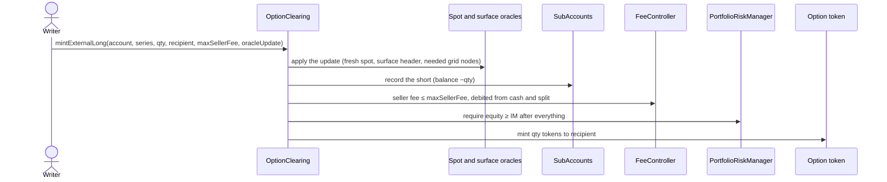

**Buy through the router**

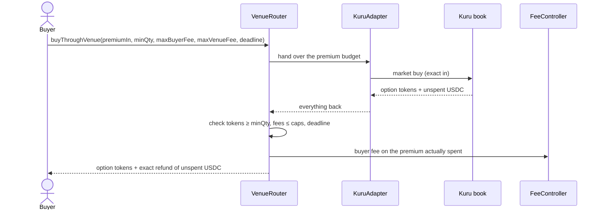

**Liquidate**

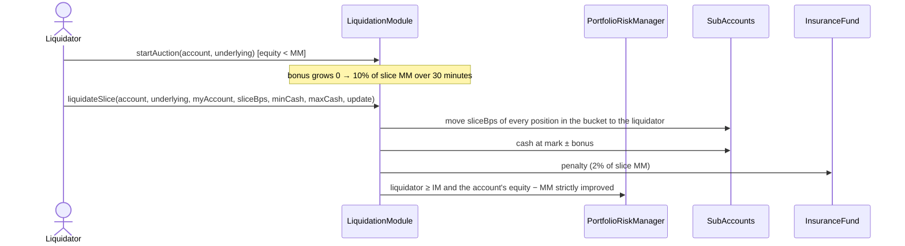

**Expiry**

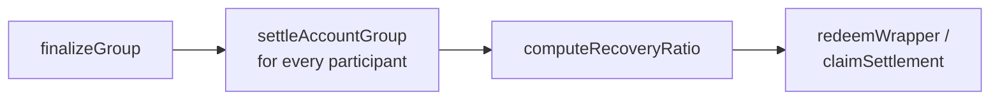

### 4.3 Boundaries that never move

- Nothing outside Optara (Kuru balances, wallet tokens, venue fills) changes Optara's accounting until assets enter
  an Optara contract.
- Kuru prices are never used for margin, liquidation or settlement.
- Series terms, finalized settlement prices and recovery ratios can never be changed, by anyone, including through
  an upgrade.

Details: [docs/ARCHITECTURE.md](docs/ARCHITECTURE.md), [docs/PROTOCOL_SPEC.md](docs/PROTOCOL_SPEC.md).

---

## 5. Margin and risk

### 5.1 What counts toward margin

| Counts | Does not count |
|---|---|
| Cash in the subaccount | Stablecoin in the wallet |
| Internal longs (unwrapped options) | Option tokens in a wallet or on Kuru |
| Internal shorts (as liabilities) | Premium sitting in a wallet or on Kuru |
| Finalized, unsettled positions at their fixed payoff | Other subaccounts, other stablecoins |

### 5.2 Stress scenarios

Every option is priced on-chain with **Black-76** from the live spot price and the signed implied volatility. Margin
is the largest equity drop of the account across a set of scenarios:

| | Scenarios | Plus |
|---|---|---|
| **Initial margin (IM)** | 24: spot −50%, −30%, −15%, 0, +15%, +30%, +50%, +100%, each with IV −30% and +75%, and the same spot shocks at the near-expiry floor (1 hour); combined with the maintenance set | A buffer of 5% of the current mark of all shorts |
| **Maintenance margin (MM)** | 12: spot −30%, −15%, 0, +15%, +30%, +50%, each with IV −30% and +30% | — |

IV is bounded between 10% and 500% in every listed product (the specification recommends a higher floor for MON,
whose volatility is synthetic). Because IM uses the union of both sets plus a buffer, IM ≥ MM always.

### 5.3 Account health

| State | Condition | What the account can do |
|---|---|---|
| **Healthy** | equity ≥ IM | Everything |
| **Close-only** | MM ≤ equity < IM | Only reduce risk |
| **Liquidatable** | equity < MM | Reduce risk; anyone may liquidate |
| **Insolvent** | equity < 0, nothing left to liquidate | Waits for settlement; shortfall goes to insurance, then the recovery ratio |

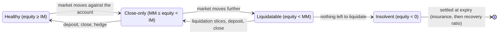

**Risk-increasing actions** need fresh oracle data and equity ≥ IM afterwards: write (mint), wrap, withdraw, close a
short with a long from another account, receiving a liquidation slice.

**Risk-reducing actions** need no oracle data and are always open (except under a guardian pause): deposit, unwrap,
close a short with option tokens, paying settlement debt.

### 5.4 Product close-only

A whole product stops accepting new risk when its surface is older than 6 hours, its surface confidence is too low,
the guardian flags it, the settlement asset's insurance fund or keeper reserve is below its minimum, or it has no
surface yet. Existing positions can still be reduced, liquidated and settled.

### 5.5 Open-interest limits

Each series has a maximum open interest and each product a maximum total short notional. Lowering a cap never forces
anyone to close; it only blocks new risk.

### 5.6 Worked example (from the specification)

ETH at 4,000; a 30-day 4,500 call (contract size 1) marks at about **106.77 USDC**.

| Position | Initial margin |
|---|---|
| Short 1 × 4,500 call (naked) | ≈ 3,418 USDC |
| Short 1 × 4,500 call + long 1 × 5,000 call in the same account | ≈ 438 USDC (the spread can lose at most 500) |

Details: [docs/MARGIN_AND_RISK.md](docs/MARGIN_AND_RISK.md), [docs/MATH.md](docs/MATH.md),
[docs/PARAMETERS.md](docs/PARAMETERS.md).

---

## 6. Oracles

Optara uses three separate oracles and never mixes them.

| Oracle | Gives | Used for | Never used for |
|---|---|---|---|
| `LiveSpotOracle` | Current underlying price | Margin, liquidation, fees, moneyness | Settlement |
| `VolSurfaceOracle` | Implied-volatility surface | Pricing options for margin and liquidation | Settlement |
| `SettlementOracle` | One price at expiry | Payoffs | Margin |

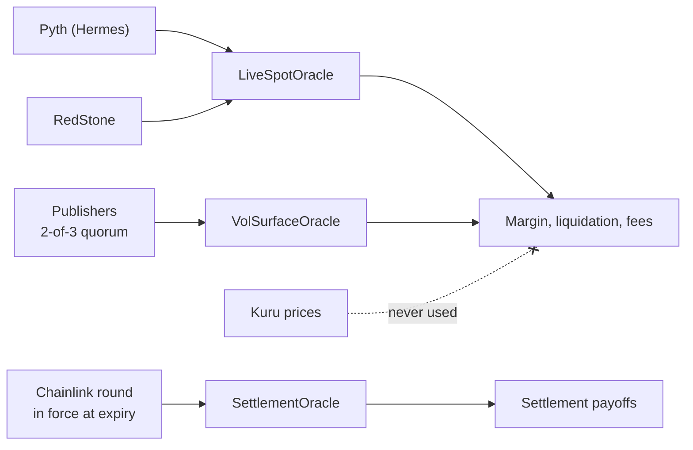

### 6.1 Live spot (pull oracles, verified on-chain at use)

- **Pyth** (`PYTH_DIRECT` / `PYTH_DERIVED`): signed price updates fetched from Hermes and included in the
  transaction. Used for WETH/USDC.
- **RedStone** (`REDSTONE_DIRECT` / `REDSTONE_DERIVED`): signed data packages from RedStone's `redstone-primary-prod`
  service, verified on-chain as the median of at least 3 distinct authorized signers. Used for MON/USDC.
- A price must be at most **60 seconds** old for risk-increasing actions and liquidation. Every such transaction
  carries its own fresh update, so the stored price never needs to be pushed constantly.
- Wide confidence intervals are rejected; an older update never overwrites a newer one.

### 6.2 Volatility surface (signed, quorum, Merkle-proven)

- Publishers calibrate an **SVI** smile per expiry (Deribit-derived for liquid assets; synthetic for MON and for
  testnet's hour-long tenors), check it for arbitrage, and sample it on a grid of up to 4 expiries × 32 moneyness
  nodes.
- The grid's Merkle root is signed (EIP-712) by a **quorum of publishers** (2 of 3 on testnet, including an
  independent signer). A transaction proves only the nodes it needs.
- Safeguards: IV bounds, a maximum ATM move per report, a confidence threshold, a short report lifetime (15 minutes,
  5 for MON), direction-aware penalties when stale (shorts at higher IV, longs at lower IV), close-only after 6 hours.

### 6.3 Settlement price (Chainlink round in force at expiry)

- Each series names a precommitted settlement config: a Chainlink-compatible feed (or a derived pair).
- `finalizeGroup` proves the round that was in force at the expiry timestamp using its immediate successor round,
  inside an observation window (5 minutes after expiry at the earliest, 7 days at the latest).
- No valid round within 7 days flags the group `ORACLE_STALLED`; prices are never invented.
- On testnet, where Chainlink has no MON feed and updates too rarely for hour-long options, a `TestnetPushFeed`
  (pusher-only, Chainlink-compatible) is filled from live prices by the keeper. Mainnet refuses push feeds.

Details: [docs/ORACLES.md](docs/ORACLES.md).

---

## 7. Trading and the Kuru integration

### 7.1 Where options trade

Each series has **one canonical Kuru order book**: base = the option token, quote = the series' settlement
stablecoin. Option tokens are plain ERC-20s, so they can also be sent directly (OTC) or traded anywhere else.

### 7.2 Optara's router (market orders)

`VenueRouter` gives users protected market orders:

```solidity
buyThroughVenue(BuyOrder{venueId, seriesId, premiumIn, minQty, maxBuyerFee, maxVenueFee, recipient, deadline}, data)
sellThroughVenue(SellOrder{venueId, seriesId, qty, minProceeds, maxVenueFee, recipient, deadline}, data)
```

It pulls the user's funds, calls the venue adapter, measures what actually came back, enforces every minimum, fee
cap and deadline, charges the buyer fee on the premium actually spent, and refunds everything unused. Router and
adapter must end every call with exactly the balances they started with.

`KuruAdapter` uses Kuru's non-margin market orders (`placeAndExecuteMarketBuy` / `placeAndExecuteMarketSell`),
converts amounts with each book's price and size precision, never rests orders and never keeps balances in Kuru.
Every market is checked against Kuru's own `Router.verifiedMarket` (base = the series' option token, quote = its
settlement asset) before it can be registered or traded.

### 7.3 Limit orders inside the app

Every option's trade page includes a full **Kuru order book UI**: the live book next to Optara's fair value and
implied volatility, limit bids and asks (`addBuyOrder` / `addSellOrder`), cancels, and deposits to and withdrawals
from Kuru's margin account. Users never have to leave Optara for Kuru and come back. Limit orders placed directly on
Kuru pay no Optara fee; Kuru's own maker and taker fees apply.

### 7.4 Kuru and Optara stay independent

| Rule | Why |
|---|---|
| A Kuru fill is not an Optara close | Buying tokens on Kuru does not reduce anyone's short until they are used to close it |
| A Kuru balance is not Optara margin | Only assets inside a subaccount count |
| Kuru prices never feed margin, liquidation or settlement | A venue can't set its own margin |
| Kuru's fee is not Optara's fee | Each is charged and shown separately |
| Kuru down is not Optara down | Minting, transfers, closing, liquidation, settlement and redemption never touch Kuru |

Details: [docs/VENUES_AND_KURU.md](docs/VENUES_AND_KURU.md).

---

## 8. Liquidation

- **When:** a risk bucket's account has equity below MM (fresh spot; a surface fresh or within 6 hours, with stale
  penalties).
- **How:** anyone calls `startAuction`; the liquidator's bonus then grows linearly from 0 to 10% of the slice's MM
  over 30 minutes. `liquidateSlice` moves 5–25% of **every** unexpired position in the bucket to the liquidator's own
  subaccount, with cash at mark ± the bonus, plus a 2% penalty to the insurance fund. After 30 minutes whole-bucket
  slices are allowed.
- **Guarantees:** every slice must strictly improve the liquidated account's `equity − MM`; the liquidator must
  carry the taken risk with its own margin (IM); the auction ends when the account is back above IM plus a 5%
  buffer, or anyone can end it once the account recovers.
- **Alternative path:** `liquidateWithWrapper` burns option tokens against the account's shorts.
- **No order-book liquidity needed:** risk moves account to account inside Optara.

Details: [docs/LIQUIDATION.md](docs/LIQUIDATION.md).

---

## 9. Settlement and redemption

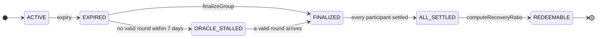

1. **Finalize** (anyone, rewarded): the settlement price is proven and stored once. Option-token supply is
   snapshotted.
2. **Settle every account** (anyone, rewarded; the reward grows +25% per hour up to 4×, so settlement always
   completes): each account's positions in the group are netted. Debts are collected from cash; credits are
   recorded as claims.
3. **Recovery ratio** (anyone, once all participants are settled): the insurance fund covers any shortfall. If a gap
   remains, one ratio below 1.0 is fixed for everyone.
4. **Redeem and claim:** token holders call `redeemWrapper` and receive `payoff × ratio`; account creditors call
   `claimSettlement` at the same ratio. Redeeming early or late changes nothing.

What changes at expiry:

| Action | Before expiry | Expired, not finalized | Finalized |
|---|---|---|---|
| Write, wrap | Allowed if healthy | Blocked | Blocked |
| Unwrap | Allowed | Blocked | Blocked |
| Close a short with tokens | Allowed | Allowed | Blocked |
| Token transfers | Allowed | Allowed | Allowed |
| Redeem | — | — | Once redeemable |

Details: [docs/SETTLEMENT.md](docs/SETTLEMENT.md).

---

## 10. Fees, insurance and keeper rewards

| Fee | Paid by | When | Base | Testnet rate |
|---|---|---|---|---|
| **Seller (open) fee** | Writer | Minting | Fair value of the minted options (with a per-asset minimum) | 0.30% (min 0.001 USDC) |
| **Buyer fee** | Buyer | Buying through Optara's router | Premium actually spent | 0.30% |
| **Liquidation penalty** | Liquidated account | Each slice | 2% of the slice's MM | → 100% insurance |
| Kuru fees | Trader | On Kuru | Kuru's maker/taker fees | Kuru's |
| Oracle update fee | Whoever submits a Pyth update | In the transaction | Pyth's | Pyth's |

Every fee has a user-set maximum, so a fee change between quote and execution can't surprise anyone. Selling through
the router and limit orders on Kuru pay no Optara fee. (The contracts default to 3% and cap at 10%; governance sets
the live rates.)

**Fee split:** 60% insurance fund, 30% treasury, 10% keeper reserve.

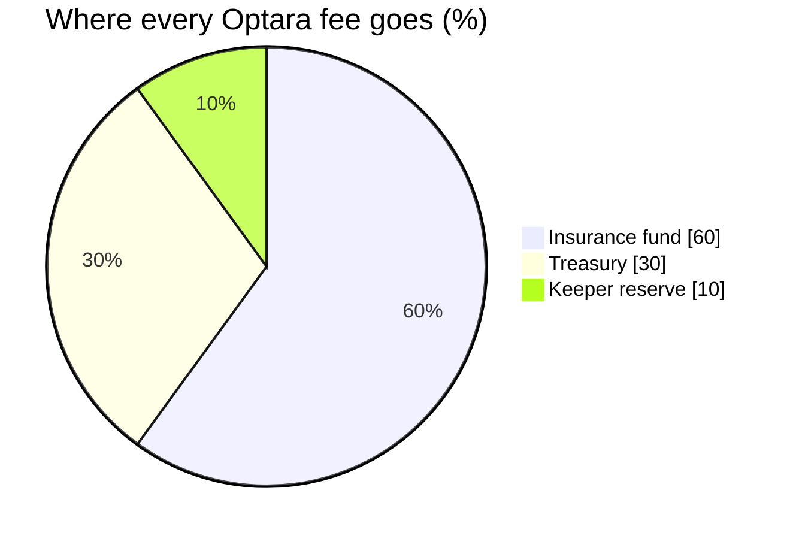

**Keeper rewards** (paid from the keeper reserve): finalizing a group, and settling each account (escalating +25% per
hour since finalization, capped at 4×).

**Insurance seed gating:** new risk in a settlement asset is blocked until its insurance fund and keeper reserve
reach their configured minimums; if either falls below, every product in that asset goes close-only until topped up.

Details: [docs/FEES.md](docs/FEES.md).

---

## 11. Governance and security

- **Roles** (in `ProtocolControl`): governance, guardian, risk admin, oracle admin, venue admin, series creator. The
  deployer renounces everything after deployment.
- **Upgrades:** every core contract sits behind `UpgradeAdmin`, which keeps an implementation allowlist and enforces
  a timelock (testnet: 7 days standard, 24 hours emergency; mainnet configuration: 24 hours). An emergency upgrade
  sets the affected products close-only immediately. Scheduled upgrades are shown on the app's System page.
- **Pauses:** the guardian can pause globally, per settlement asset or per product, and set products close-only.
- **Conservative-only shortcuts:** changes that only reduce risk (raising reserve minimums, tightening caps) are
  instant; anything that adds risk goes through the timelock.
- **What can never change:** series terms, finalized settlement prices, recovery ratios.
- **Source verified:** every contract on testnet is verified on Sourcify and on MonadVision.
- **Tested:** unit, fuzz, invariant, differential (Solidity vs an independent Python reference model), gas, end-to-end
  and fork tests (Kuru on a Monad mainnet fork); see [docs/TESTING.md](docs/TESTING.md).

Details: [docs/ACCESS_CONTROL.md](docs/ACCESS_CONTROL.md), [docs/SECURITY.md](docs/SECURITY.md),
[docs/INVARIANTS.md](docs/INVARIANTS.md).

---

## 12. Capital efficiency and composability

**Capital efficiency**

- **Portfolio margin:** collateral is the account's worst loss across stress scenarios, not each option's maximum
  payout. A call spread needs roughly its maximum loss (≈ 438 vs ≈ 3,418 USDC for the naked call in §5.6).
- **Cash-settled in one stablecoin:** writing calls on WETH or MON needs no WETH or MON.
- **One balance, many positions:** a single USDC balance backs every series a user writes on a product, across
  strikes and expiries.
- **Premium is reusable:** proceeds from selling options on Kuru can be deposited straight back as margin.
- **Dutch-auction liquidation:** risk moves in slices before insolvency, so margin is set from scenarios rather than
  padded for thin order books.

**Composability**

- Options are standard ERC-20 tokens (with permit): transferable, usable in vaults or as collateral elsewhere,
  tradable on any venue, redeemable by whoever holds them.
- Positions move freely between a margin account (where they hedge) and a wallet (where they are free-floating).
- Router, liquidation and every keeper function are permissionless: other protocols and bots use the same contracts
  as the app.
- Option-token addresses are deterministic: they are known before a series is created, so books and integrations can
  be prepared in advance.
- A public indexer API exposes series, positions, Kuru orders, settlement state and auctions.

---

## 13. User guide

The app runs at **<https://optara-2et.pages.dev>** (Monad testnet). The app section lives under `/app`.

### 13.1 Get set up

1. **Wallet:** use any EVM wallet (MetaMask, Rabby, etc.). Click **Connect** in the top bar. If your wallet is on
   another network, the app asks it to switch to **Monad testnet (chain ID 10143)** before any transaction.
2. **Gas:** get testnet MON from the Monad faucet (<https://faucet.monad.xyz>).
3. **USDC:** testnet options settle in **Circle USDC** (`0x534b2f3A21130d7a60830c2Df862319e593943A3`). Get it from
   Circle's faucet (<https://faucet.circle.com>, choose *Monad Testnet*).
4. **Pick a market:** the market picker in the top bar switches between **WETH/USDC** and **MON/USDC**. The live spot
   price and its source (Pyth or RedStone) are shown next to it.

### 13.2 Pages at a glance

| Page | Path | What it's for |
|---|---|---|
| Markets | `/app/markets` | Every option of the selected product: search, filter (active, expiring soon, expired, yours), sort, and the action switch **Up** (buy calls), **Down** (buy puts), **Earn** (write options) |
| Option page | `/app/series/<id>` | One option, with tabs **Trade** (buy/sell now, Kuru limit orders and book), **Earn** (write it), **Position** (unwrap, close, wrap) and **Settle** (redeem, claim) |
| Kuru order book | `/app/series/<id>/orderbook` | The full Kuru book and your Kuru orders for that option |
| Write | `/app/write` | A guided flow to write calls or puts with a margin preview |
| Portfolio | `/app/portfolio` | Your margin accounts: cash, deposits and withdrawals, positions, health, history and profit and loss |
| Settlement | `/app/settlement` | Expiries and their status: finalize, settle, recovery ratio, redeem |
| Liquidations | `/app/liquidations` | Accounts below maintenance margin and running auctions |
| System status | `/app/system` | Oracle freshness, reserves, scheduled upgrades, services and every contract address |
| New market | `/app/new` | Propose a new strike and expiry |
| Admin | `/app/admin` | Appears only for wallets that hold a protocol role |

### 13.3 Buying an option (bet on a move)

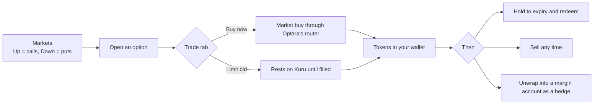

1. Go to **Markets**, choose **Up** for calls or **Down** for puts.
2. Each row shows the strike, the price per option (the best Kuru ask, or the fair value when the book is empty) and
   how far the price must move for you to profit. Open a row.
3. On the **Trade** tab, choose **Buy now**, enter a USDC budget, and check the preview: options received, price,
   Optara's buyer fee and Kuru's fee shown separately, and the minimum you accept.
4. Approve USDC once, then confirm. The options arrive in your wallet; any unspent USDC is refunded exactly.
5. Prefer your own price? Use the Kuru limit-order panel on the same tab to place a **bid**. It rests on Kuru until
   it fills or you cancel it.

What you can do next: hold to expiry, **sell** any time on the same tab, send the tokens to someone, or **unwrap**
them into a margin account to hedge your own shorts (Position tab).

### 13.4 Writing an option (earn premium)

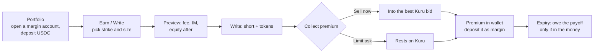

1. **Open a margin account:** in **Portfolio**, create an account and make a first USDC deposit. (The Write flow also
   offers this.)
2. Go to **Markets → Earn** or **Write**, pick calls or puts and a strike.
3. Enter the quantity. The preview shows the fair value, the seller fee, your initial margin and equity after the
   trade, and whether it passes. The Write button explains why if it is disabled (for example: not enough margin,
   prices delayed, product close-only, open-interest cap reached).
4. Confirm. A short is recorded in your account and the option tokens arrive in your wallet.
5. **Collect the premium:** sell the tokens with **Sell now** (into the best Kuru bid) or post an **ask** with the
   Kuru limit-order panel. The premium lands in your wallet. Deposit it into your margin account to strengthen it.
6. **At expiry** you owe the payoff only if the option finishes in the money; it is taken from your account's cash
   during settlement.

### 13.5 Managing positions and margin

| Goal | How |
|---|---|
| Add margin | Portfolio → your account → **Add cash** |
| Withdraw free margin | Portfolio → **Withdraw** (only what keeps the account above IM) |
| Hedge a short | Buy the protecting option (e.g. a higher-strike call) and **Unwrap** it into the same account |
| Close a short | Buy back the same option's tokens and use **Close** (burns them against your short) |
| Take a long back out of the account | **Wrap** it into tokens (the account must stay healthy without it) |
| Watch your risk | Portfolio shows equity, IM, MM and the health state; amber = close-only, red = liquidatable |

If your account turns **close-only** (amber) you can only reduce risk: deposit, close or unwrap hedges. If it turns
**liquidatable** (red), act quickly: anyone may start an auction on it.

### 13.6 Kuru limit orders from the app

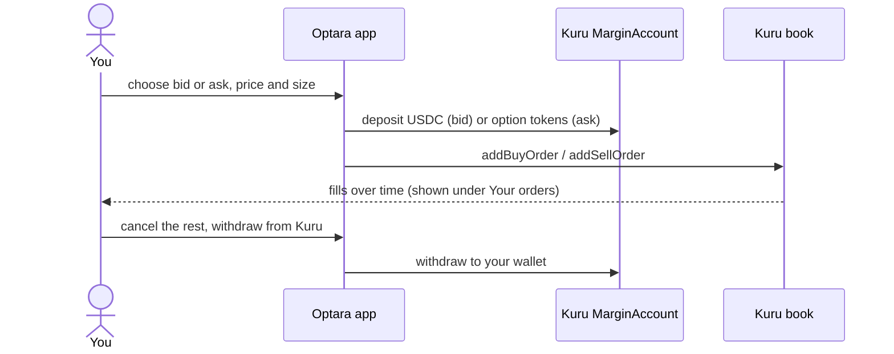

1. On an option's **Trade** tab, open the Kuru panel.
2. **Deposit** to Kuru's margin account the asset the order needs: USDC for a bid, option tokens for an ask.
3. Set price and size. They snap to the book's price step and lot size; the panel shows the step if your price is
   below it.
4. Place the order. It appears under **Your orders** (Active / Filled / All) and on the book.
5. **Cancel** any time; **withdraw** your Kuru balance back to your wallet when done.

Kuru's book and Optara's margin are separate: tokens and USDC inside Kuru's margin account do not count as Optara
margin.

### 13.7 Expiry, settlement and redemption

1. After expiry, the **Settlement** page and the option's **Settle** tab show each step: finalized → all accounts
   settled → recovery ratio set.
2. Keepers normally run these steps automatically. Anyone can press the buttons (and earn the keeper reward).
3. Once redeemable, **Redeem** your tokens for `payoff × recovery ratio` in USDC. Account creditors use **Claim**.
4. Tokens sitting in Kuru's margin account must be withdrawn to your wallet first.

### 13.8 Liquidators

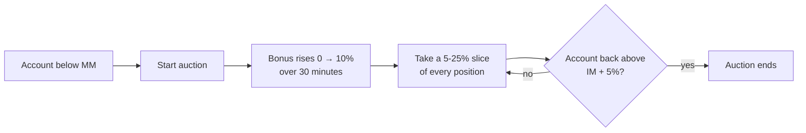

1. Fund a margin account in the same settlement asset (it must carry the risk you take over).
2. Watch **Liquidations** for accounts below MM; **Start auction** on the bucket.
3. The bonus rises over 30 minutes. Preview a slice (5–25%), then **Liquidate**. You receive a share of every
   position in the bucket plus cash at mark ± the bonus.
4. Hedge or close what you took over. A reference bot ships in `keepers/` (`liquidate` mode).

### 13.9 Keepers and publishers

Keepers (`keepers/`) refresh oracles, push testnet settlement feeds, finalize groups and settle accounts; all of it
is permissionless and rewarded from the keeper reserve. Publishers (`publisher/`) sign volatility surfaces and serve
fresh oracle updates to the app. See [§19](#19-operations-markets-services-and-hosting).

---

## 14. Risks every user should understand

- **Writers can be liquidated** if the market moves against them; liquidation costs a discount and a penalty.
- **Buyers can receive less than 100%** of the payoff if bad debt exceeds the insurance fund (the recovery ratio).
- **Oracle and publisher dependence:** if prices or surfaces stop, new risk stops (existing positions can still be
  reduced and settled).
- **Upgradeable contracts:** governance can upgrade behind a timelock; scheduled upgrades are visible in the app.
- **MON volatility is synthetic:** there is no liquid MON options market to derive it from.
- **Testnet:** testnet assets have no value; contracts and parameters may change.

---

## 15. Troubleshooting and FAQ

| You see | Meaning | What to do |
|---|---|---|
| "Wrong network" / chain ID mismatch | Your wallet is on another chain | Approve the switch to Monad testnet (10143) when the app asks |
| "Requests limited" / rate limited | The public RPC is throttling | Wait a few seconds; the app retries automatically |
| Price "Delayed" / "Volatility data delayed" | Stored spot or surface is stale | Risk-increasing actions carry a fresh update automatically; if the publisher is down, wait |
| **Close only** on a product | Surface too old, low confidence, reserves below minimum, or set by the guardian | Only reduce risk until it clears |
| `NotHealthy` | The action would leave equity below IM | Add cash, reduce size, or hedge first |
| Seller fee above max | The fee moved between preview and execution | Refresh the preview and retry |
| Limit price rejected / "below the price step" | Kuru books have a minimum price step | Use a price on the step shown in the panel |
| Nothing to buy | The Kuru book has no asks | Place a bid, or write the option yourself |
| Can't redeem yet | The group isn't finalized, settled or ratio-fixed | Follow the steps on the Settlement page |

**Is my premium margin?** Only after you deposit it into your margin account.
**Can I trade without Kuru?** Yes: option tokens are ERC-20s; send them directly (OTC). Settlement and redemption
work without any venue.
**Do I need to come back at expiry?** Keepers finalize and settle automatically; you only need to redeem.
**Are options American?** No, European: they pay only at expiry.

---

## 16. Deployments

### 16.1 Monad testnet (live)

| | |
|---|---|
| App | <https://optara-2et.pages.dev> |
| Chain ID | 10143 |
| Products | WETH/USDC (spot: Pyth), MON/USDC (spot: RedStone); 120 series listed so far |
| Settlement asset | Circle USDC `0x534b2f3A21130d7a60830c2Df862319e593943A3` |
| Kuru Router (classic) | `0x7EFbE105Ca7415dE98F96622173458ac1c054630` · MarginAccount `0xd029C2D98ff85D8F64799017fE00a59B1159CE02` |
| Full list with verified sources | [deployments/testnet-contracts.md](deployments/testnet-contracts.md) · machine-readable: [deployments/monad-testnet.json](deployments/monad-testnet.json) |

Core proxies (use these addresses):

| Contract | Address |
|---|---|
| OptionClearing | `0xdEC1475De4bD2a2F603078b9B173548272CAe516` |
| SubAccounts | `0x42c210fA3Faa8A0CE85aDBc43CE0B71d4c8fccbE` |
| OptionSeriesRegistry | `0xd927124E0Cb73F3bfbAB164621E3872Ebe9391a1` |
| ExternalOptionFactory | `0x2b4820042F97f1e49797aecE85882511C386c272` |
| PortfolioRiskManager | `0x6425d89AC6f69EED97FE90b3E2C1E2C3FEb33A1B` |
| LiveSpotOracle | `0xB3dE745DC7180Bc57e728C823fDe2Bc5334522Ac` |
| VolSurfaceOracle | `0x761869Fb5080f750acc6D102177147f36bb54EfA` |
| SettlementOracle | `0xC2F449414032E71ab9e7f99aec3144b32AFf310D` |
| SettlementWindow | `0x9f9F4d1245D7B98859923572997B1ACD741Cd5d7` |
| LiquidationModule | `0xc5155C5B64519b9E00D6F0E7f94BCb4Ee3252079` |
| FeeController | `0xF4F5C905e374ccEABf4bCf4aBA4452114C19A352` |
| InsuranceFund | `0x549521976aD368cAEA86cDd891c0C9c2EC5335f0` |
| VenueRegistry | `0x64e50b0453C7E1382b9746B0bEbDA5390Bc7b27A` |
| VenueRouter | `0xD6A20C0A7D47a83beC5f996aC111CE23C0f597E7` |
| KuruAdapter | `0x0A7Ad975042B36829d4760994e2d40d6b2Ba9F6E` |
| ProtocolControl | `0xB732390FDa549BF44a83F0CF452e860B2961B1B0` |
| UpgradeAdmin | `0x239aA4bC39FA718C80E1d71D879616Eb6E3B54a1` |

Testnet settlement feeds (`TestnetPushFeed`): WETH/USDC `0x575AeAeF1A3E1670bc25cC205184b6aC7ad3075f`, MON/USDC
`0x31FA8a075D4adAd7390a6bA8152B3F38361807A2`.

### 16.2 Monad mainnet (configured, not deployed)

| | |
|---|---|
| Configuration | [deployments/config/monad-mainnet.json](deployments/config/monad-mainnet.json), [monad-mainnet.markets.json](deployments/config/monad-mainnet.markets.json) |
| Products | WETH/USDC, MON/USDC; daily and weekly expiries at 08:00 UTC; strikes at −10%, −5%, ATM, +5%, +10% |
| Settlement asset | USDC `0x754704Bc059F8C67012fEd69BC8A327a5aafb603` |
| Kuru (production) | Router `0xd651346d7c789536ebf06dc72aE3C8502cd695CC` · MarginAccount `0x2A68ba1833cDf93fa9Da1EEbd7F46242aD8E90c5` (Kuru deploys the option books; market creation is owner-gated on mainnet) |
| Execution | Every role-holder action is written as a multisig proposal (`execution: propose`); nothing is broadcast by scripts |

---

## 17. Repository layout

| Folder | What it is |
|---|---|
| [`contract/`](contract/README.md) | Foundry project: the on-chain protocol, its tests and deployment scripts |
| `sdk/` | Shared TypeScript: chain clients, ABIs, manifests, series catalog, spot sources (Pyth, RedStone), surface reports, oracle updates, settlement proofs |
| `publisher/` | Volatility-surface publisher service (calibration, quorum signing, `/oracle-update` API) |
| `keepers/` | Oracle pusher, testnet feed pusher, settlement keeper, reference liquidation bot |
| `indexer/` | Envio HyperIndex indexer (events → Postgres/GraphQL) plus the REST API, health worker and monitor |
| `frontend/` | The web app (React, Vite, wagmi/viem, Tailwind), including landing page, docs and blog |
| `deployments/` | Per-network configs, deployment manifests, listing proposals, series lists, exported ABIs, contract lists |
| `scripts/` | `markets.sh` (deploy, list, roll, register, verify, wire), contract-list generator, devnet helpers |
| [`reference/`](reference/README.md) | Independent Python reference model, math and invariant verification, test vectors |
| [`docs/`](docs/README.md) | The normative protocol specification |
| [`brand/`](brand/README.md) | Logos, icons, social images |

---

## 18. Developer guide

### 18.1 Prerequisites

Node ≥ 22.15, pnpm 10, Foundry, Python 3 (reference model), and Docker for the indexer's Postgres in local runs.

### 18.2 Run everything locally

```bash
pnpm install
(cd contract && forge build)
pnpm dev            # local devnet: anvil + full deployment + publisher + keepers + frontend
# or: pnpm dev:fork # the same against a fork
```

Open <http://localhost:5173> and connect one of the funded test wallets the devnet prints. `pnpm kill:devnet` stops
it.

### 18.3 Tests

```bash
# contracts: unit, fuzz, invariant, differential, gas, e2e
cd contract && forge test
# fork tests against real Kuru (network access)
FOUNDRY_PROFILE=fork forge test
# Kuru on testnet instead of mainnet:
FOUNDRY_PROFILE=fork FORK_RPC_URL=https://testnet-rpc.monad.xyz \
  KURU_ROUTER=0x7EFbE105Ca7415dE98F96622173458ac1c054630 \
  KURU_MARGIN_ACCOUNT=0xd029C2D98ff85D8F64799017fE00a59B1159CE02 \
  forge test --match-contract KuruAdapterForkTest

# reference model and spec traceability
python3 reference/verify_math.py --n 3000
python3 reference/verify_invariants.py --runs 400 --steps 200
python3 reference/check_traceability.py

# services and frontend
pnpm --filter @optara/indexer codegen
pnpm -r typecheck
pnpm -r --workspace-concurrency=1 test
```

### 18.4 Frontend configuration

| Variable | Meaning |
|---|---|
| `VITE_NETWORK` | `local` (default), `monad-testnet` or `monad-mainnet`; addresses and ABIs come from `deployments/<network>.json` |
| `VITE_RPC_URL` | RPC endpoint (defaults to the network's public RPC) |
| `VITE_PUBLISHER_URL` | Surface publisher (`/oracle-update`) for fresh prices |
| `VITE_INDEXER_URL` | Indexer API (optional; lists fall back to on-chain events) |

Build: `pnpm --filter @optara/frontend build` (output in `frontend/dist`). The app reads contracts through Multicall3
batching and simulates every risk-changing action with fresh oracle data before sending it.

### 18.5 Service configuration

| Service | Start | Key variables |
|---|---|---|
| Publisher | `pnpm --filter @optara/publisher start` | `RPC_URL`, `CHAIN_ID`, `MANIFEST`, `PUBLISHER_PRIVATE_KEY` (comma-separated for several), `PRODUCTS`, `SPOT_SOURCE=hermes`, `HERMES_URL`, `HERMES_API_KEY`, `INDEXER_URL` |
| Keepers | `pnpm --filter @optara/keepers start` | `RPC_URL`, `CHAIN_ID`, `MANIFEST`, `KEEPER_PRIVATE_KEY`, `KEEPER_MODES` (`oracle settle feeds liquidate`), `PUBLISHER_URL`, `INDEXER_URL`, `ORACLE_REFRESH_SECONDS`, `ORACLE_ACTIVE_SECONDS`, `FEED_INTERVAL_SECONDS` |
| Indexer | `pnpm --filter @optara/indexer start` | Envio's `ENVIO_PG_*` variables and `ENVIO_PG_SCHEMA` (one schema per deployment) |
| Indexer API | `pnpm --filter @optara/indexer api` | `RPC_URL`, `CHAIN_ID`, `MANIFEST`, `ENVIO_PG_*`, `PORT` |

Private keys are read from environment files that are git-ignored; never commit them.

---

## 19. Operations: markets, services and hosting

### 19.1 `scripts/markets.sh`

One script runs a network end to end. Everything that differs between testnet and mainnet is configuration
(`deployments/config/<network>*.json`), never code.

```bash
NETWORK=monad-testnet scripts/markets.sh <command> [products] [--yes]
```

| Command | What it does |
|---|---|
| `deploy` | Fresh contracts (the previous manifest is archived), then the deployment checks |
| `list` | Per product: its settlement feed (push networks) and the listing calls |
| `roll` | Options for every configured expiry and strike at live-price strikes, plus their Kuru books where the network deploys them |
| `register` | Register Kuru books that Kuru deployed (mainnet) |
| `verify` | Verify every contract on Sourcify and MonadVision |
| `wire` | Indexer config, publisher products and the contracts list; `--railway` also sets the services' non-secret variables |
| `all` | deploy, list, roll, verify, wire |

On mainnet (`execution: propose`) the script broadcasts nothing; it writes every role-holder call to
`deployments/<network>.*.proposals.json` for the multisigs.

### 19.2 Hosting

| Component | Where (testnet) |
|---|---|
| Frontend | Cloudflare (`frontend/wrangler.jsonc`, static assets with single-page-app routing) |
| Publisher, keepers, indexer, indexer API | Railway services built from this repository |

On restart, the publisher and keepers load the series catalog from the indexer API (`INDEXER_URL`), so they are
pricing again within seconds instead of rescanning the chain.

Deployment order, configuration and launch gates: [docs/DEPLOYMENT.md](docs/DEPLOYMENT.md). Services:
[docs/INDEXER_AND_KEEPERS.md](docs/INDEXER_AND_KEEPERS.md).

---

## 20. Documentation index

| Document | Read it to learn |
|---|---|
| [GLOSSARY](docs/GLOSSARY.md) | Every term, in plain language |
| [PRD](docs/PRD.md) | Goals, users, requirements and acceptance criteria |
| [ARCHITECTURE](docs/ARCHITECTURE.md) | Contracts, who calls whom, data ownership |
| [OPTION_SPEC](docs/OPTION_SPEC.md) | Series terms, payoff, identity, the option token |
| [MATH](docs/MATH.md) | Every formula: pricing, equity, margin, fees, liquidation, settlement, rounding |
| [MARGIN_AND_RISK](docs/MARGIN_AND_RISK.md) | Stress scenarios, health, close-only, staleness |
| [ORACLES](docs/ORACLES.md) | Spot, volatility surface and settlement oracles |
| [LIQUIDATION](docs/LIQUIDATION.md) | Dutch slice auctions, wrapper-burn liquidation, bad debt |
| [SETTLEMENT](docs/SETTLEMENT.md) | Expiry, settlement window, recovery ratio, redemption |
| [FEES](docs/FEES.md) | Seller, buyer and venue fees, split, insurance seed |
| [VENUES_AND_KURU](docs/VENUES_AND_KURU.md) | Venue registry, router, Kuru adapter |
| [PROTOCOL_SPEC](docs/PROTOCOL_SPEC.md) | Every external function: checks, effects, events, errors |
| [STATE_MACHINE](docs/STATE_MACHINE.md) | Lifecycles of series, groups, accounts, products |
| [INVARIANTS](docs/INVARIANTS.md) | Properties that must always hold |
| [ACCESS_CONTROL](docs/ACCESS_CONTROL.md) | Roles, timelocks, upgrades |
| [SECURITY](docs/SECURITY.md) | Threat model and mitigations |
| [PARAMETERS](docs/PARAMETERS.md) | Every configurable number and its default |
| [USER_FLOWS](docs/USER_FLOWS.md) | Step-by-step journeys with the exact calls |
| [FRONTEND](docs/FRONTEND.md) | Pages, data, previews, copy and errors of the app |
| [INDEXER_AND_KEEPERS](docs/INDEXER_AND_KEEPERS.md) | Indexer, keepers, liquidation bot, publisher |
| [TESTING](docs/TESTING.md) · [TEST_CASES](docs/TEST_CASES.md) | Test strategy and the required test catalog |
| [DEPLOYMENT](docs/DEPLOYMENT.md) | Deployment order, configuration, manifests, runbook |
| [DESIGN_DECISIONS](docs/DESIGN_DECISIONS.md) | Why each choice was made |
